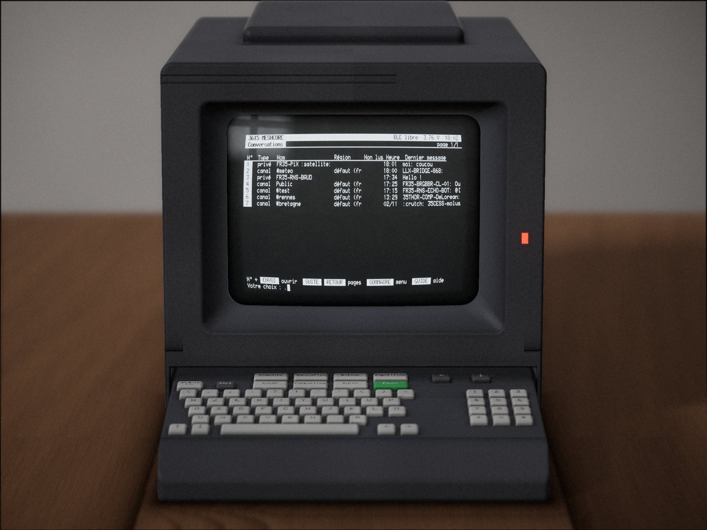

# 3615 MESHCORE

**A [MeshCore](https://github.com/meshcore-dev/MeshCore) LoRa mesh companion whose screen and keyboard are a real French Minitel 2.**

A Seeed XIAO nRF52840 with a Wio-SX1262 sits behind the terminal, wired to its DIN port through a one-transistor interface. On the Minitel you read the mesh, write to it and look after your repeaters, in Télétel style: a service line, inverse title bars, a *Sommaire*, choices typed as a number then **Envoi**. The MeshCore phone app keeps working alongside, with the same identity, contacts and channels.



*The conversation list, rendered from a real `screen` dump of the device by `tools/screenshot/minitel_render.py` (a render, not a photograph).*

Website (in French): **https://pix.github.io/3615meshcore/**, built from `site/`: every screen of the service, features, build guide, reference.

> **En français.** 3615 MESHCORE est un compagnon radio MeshCore dont l'écran et le clavier sont un vrai Minitel 2, piloté par un Seeed XIAO nRF52840 et un Wio-SX1262 branchés sur la prise péri-informatique. Toute la documentation (écrans, fonctions, montage, référence, dépannage) est en français sur le site ; ce README en donne l'essentiel en anglais.

## Features

- **Conversations** on channels, direct messages and rooms, with a history in flash (40 messages × 48 conversations), delivery marks (`(reçu)`, `(échec ?)`), and the hops and SNR of every received message. History back-fill over USB.
- **Dernières nouvelles**: the newest messages of every conversation, merged by time.
- **Contacts**, stations heard on the air, **nearby stations** by distance and bearing, contact sheets with path reset, **trace**, **sharing**, favourites, add-by-key.
- **Rooms and repeater administration**: login, status, neighbours, telemetry, and a **remote console**.
- **Graphs** of SNR, RSSI, noise floor, traffic, airtime against the sub-band duty cycle, battery, best-heard stations, hop counts: Vidéotex G1 mosaics in 40 columns, text plots in 80.
- **French flood regions** named the Gaulix way (`eu > fr > fr-bre > fr-35`), suggested from your position or typed département.
- **Emoji turned into ASCII** (`:-)`, `(y)`, `:pizza:`, `:flag-fr:`); radio text is sanitised so nothing can drive the terminal.
- **Accents typed the Minitel way**: the dead keys, the French set's keys, and `*'e`-style composition.
- A conversation **Actions** page (ENVOI on an empty line): reply, resend, delete a message, message details, search, quick replies, silence, mark all read. Your own channel messages show how many times relays were heard repeating them.
- An **animated welcome page** in four scenes, cheap enough at 9600 baud that a key always enters at once.
- **Both Minitel modes**: Vidéotex 40 columns and Mixte 80 columns.
- **USB command line**: identity backup, clock, history import, **screen dumps**, and **driving the whole UI** from a script.
- **Crash capture** that survives the reset, resolved to a source line from the kept ELF.
- **Standby and répertoire handling**: the node keeps working while the Minitel is off, and sets it up again when it comes back.

## Hardware

| Part | Notes |
|---|---|
| Minitel 2 with the 5-pin DIN "prise péri-informatique" | Developed and tested on a Philips Minitel 2, ROM `Bv9`; other models untested |
| Seeed XIAO nRF52840 + Wio-SX1262 | LoRa on D1–D5, D8–D10 as in MeshCore's `Xiao_nrf52` variant |
| 2N2222A, resistors 10k, 22k, 220k, 9.1k | the interface |
| Male DIN-5 180° plug | |

The interface is **arduiblog's 2N2222A board** from ["Ressuscitez le Minitel"](https://arduiblog.com/2019/04/29/ressuscitez-le-minitel/), powered from the XIAO's **3V3, not 5 V**. It does not invert, so no UART inversion is needed (the nRF52840 cannot invert anyway).

| Interface wire | XIAO |
|---|---|
| the transistor's free outer leg (emitter) | **D6** (Serial1 TX) |
| the wire joined to the 220k and DIN 3, **through a 9.1 kΩ resistor in series** | **D7** (Serial1 RX) |
| supply (220k and 10k) | **3V3** |
| ground (22k and DIN 2) | **GND** |

Minitel DIN pinout, seen from the back of the Minitel (= your plug from its solder side), left to right along the arc: **3 5 2 4 1**.

| DIN pin | Signal | Wire |
|---|---|---|
| 1 | RX, the Minitel's input | transistor collector |
| 2 | GND | XIAO GND |
| 3 | TX, the Minitel's output (open collector) | 220k pull-up to 3V3, then 9.1k to D7 |
| 4 | PT | not connected |
| 5 | +8.5–15 V supply output | **not connected, insulate** |

- If `link log` shows parity errors at 9600 baud, lower the 220k pull-up to about 10k: the weak line picks up glitches from the CRT.
- The Minitel env moves I2C to the NFC pads (`CONFIG_NFCT_PINS_AS_GPIOS`, SDA 30, SCL 31). The first boot writes the UICR, so NFC is gone for good on that XIAO.
- `firmware/minitel-test/` is a stand-alone bring-up sketch for the link alone (`help` on USB). Its README has the verified wiring and test results.
- `hardware/` holds an earlier interface design for a Heltec V3 (KiCad, generated by scripts), kept for reference; the current build is the arduiblog board above.

The build guide on the website (*Montage* page) has the schematic and the DIN drawing.

## Firmware

The firmware and its source are published as a [GitHub release](https://github.com/pix/3615meshcore/releases/latest):

| File | |
|---|---|
| `3615meshcore-xiao_nrf52.uf2` | XIAO nRF52840: double-tap reset, copy it to the USB drive that appears |
| `3615meshcore-xiao_nrf52-dfu.zip` | the same, for serial DFU (`adafruit-nrfutil dfu serial … --touch 1200`) |
| `3615meshcore-firmware-src.tar.gz` | the source: MeshCore's companion radio with the Minitel UI |
| `SHA256SUMS` | checksums |

The UF2 is the application only, for the XIAO's stock bootloader (S140 v7), like any MeshCore XIAO build.

To build it yourself (code in `examples/companion_radio/ui-minitel/`, env `Xiao_nrf52_companion_minitel` in `variants/xiao_nrf52/platformio.ini`, full notes in `docs/companion-minitel.md`):

```sh
tar xzf 3615meshcore-firmware-src.tar.gz
cd 3615meshcore-firmware
pio run -e Xiao_nrf52_companion_minitel -t upload --upload-port /dev/ttyACM0
```

Flashing keeps the file system (identity, contacts, channels, history). If the 1200-baud reset touch misses, retry, or double-tap the XIAO's reset and upload to the bootloader.

First boot: the Minitel starts on its local *répertoire*: leave it with **Fnct + Sommaire**, and disable its automatic standby with **Fnct + E, then A** (**Fnct + E, then M** turns it back on; kept in EEPROM, ROM CV5/BV9 and later). The firmware finds the terminal, switches it to 9600 baud and shows the welcome page. 40/80 columns: RÉPÉTITION on any page, or Réglages 10. The Bluetooth pairing code is drawn at random at each boot and shown on the Minitel when a phone pairs; a fixed one can be set in Réglages 15 (`0` = random again).

### Back up the identity

The node *is* its private key. If the file system is ever erased, it gets a new one. Back it up once over USB:

```
get prv.key          # 128 hex digits: keep them offline
set prv.key <hex>    # restore, then reboot
```

> **Warning.** Anyone with the private key can impersonate the node and read its direct messages. Never paste it into chats, tickets, logs or screenshots.

### USB CLI cheatsheet

USB serial at 115200 baud, CR line ends; replies are indented and end with `OK` or `ERR …`.

| Command | |
|---|---|
| `get prv.key` / `set prv.key <hex>` | identity backup / restore (secret!) |
| `get tz.offset` / `set tz.offset <h>` | time zone, −12 … +14 |
| `clock` / `clock sync <unix>` | read / set the RTC (UTC) |
| `hist list` / `hist add …` / `hist clear <conv>` | history: list, import (never sent), clear |
| `stack`, `boot`, `boot clear` | stack high-water mark and heap; last restart reason and crash record |
| `link log`, `link try <hex>`, `link txlog on\|off\|dump\|clear` | Minitel link diagnostics |
| `ui cursor none\|csi\|cof\|dec`, `redraw` | 80-col cursor hiding; resend the page |
| `screen`, `screen watch <frames> <ms>` | dump the screen model (format v1) |
| `key <name>…`, `type <text>`, `typehex <hex>` | press keys, type text |
| `wait idle [ms]`, `ui state`, `ui reset` | sync with the UI, where it is, back to the Sommaire |
| `splash scene <0-3\|off>`, `splash speed [ms [s]]` | hold a welcome-page scene; its pace |

The full reference, with the dump format, is on the website.

## Host tools

Python 3, run with `python3 -I`. They find the XIAO as `/dev/serial/by-id/*3C0B547619DCA64A*` (edit the serial for yours) and refuse any `/dev/ttyUSB*` device.

| Tool | |
|---|---|
| `tools/screenshot/minitel_dump.py` | fetch a `screen` dump over USB |
| `tools/screenshot/minitel_render.py` | photo-realistic render of a Minitel 2 showing a dump (PNG, GIF, CRT face only); numpy + Pillow. See its README. |
| `tools/tour/tour.py` | walk every page in 40 and 80 columns, save the dumps and `gallery/manifest.json`, record the welcome animation (`screen watch`), rebuild the site. Visits pages only: never sends on the radio. `simulate` tests it offline; `--render` optionally makes photo renders. |
| `site/build.py` | build the website into `site/dist/` (plain files); standard library only |
| `site/tools/make_webfont.py` | rebuild the Minitel web fonts (fontTools, numpy) |

### The website and the gallery

```sh
python3 -I tools/tour/tour.py run --firmware <commit>   # with the XIAO on USB: real captures, then the site
python3 -I site/build.py --check                         # build site/dist/ and check its links
python3 -m http.server -d site/dist     # preview
```

Every screen of the gallery is a real capture from the device, drawn as text by the browser in the Minitel web fonts (mosaics, double size, blink, inverse; selectable and copyable). The only picture on the site is the hero render. The site is static and needs no image renderer.

## Repository layout

```
docs/img/            README pictures
firmware/minitel-test/  bring-up sketch for the link (PlatformIO)
gallery/             real screen dumps + manifest.json
hardware/            earlier Heltec V3 interface (KiCad, generated)
ref/                 protocol notes (third-party manuals are not included)
site/                the website: build.py, content/, templates/, assets/ (fonts, CSS, JS)
tools/screenshot/    dump fetcher, photo renderer, Minitel font
tools/tour/          tour.py
```

## Credits and licences

- **MeshCore** by Scott Powell / rippleradios.com and contributors, MIT.
- **Minitel font**: `Minitel.ttf` / `.sfd` by Frédéric Bisson ([zigazou/minitel-canvas](https://github.com/zigazou/minitel-canvas)), CC0 1.0 (`tools/screenshot/font/LICENSE`). The site's web fonts are rebuilt from it (CC0 as well).
- **Region naming**: [Gaulix, "Règles de nommage des régions et canaux MeshCore"](https://gaulix.fr/docs-parametrage/regles-de-nommage-regions-canaux-meshcore/) and its region generator. Names and geography: INSEE Code officiel géographique 2026 and geo.api.gouv.fr, Licence Ouverte 2.0.
- **Emoji data**: Unicode `emoji-test.txt` (Unicode License v3), github/gemoji (MIT), iamcal/emoji-data (MIT).
- **Interface**: arduiblog, ["Ressuscitez le Minitel"](https://arduiblog.com/2019/04/29/ressuscitez-le-minitel/).
- `firmware/minitel-test/sd_api/` are Nordic Semiconductor SoftDevice headers under their own licence (in each file).
- Not affiliated with Orange, France Télécom, Philips, Seeed Studio or the MeshCore project. "Minitel", "Télétel" and "3615" are used descriptively; no logos.

This repository's own code and documentation: **licence to be chosen** (TODO before publishing).
