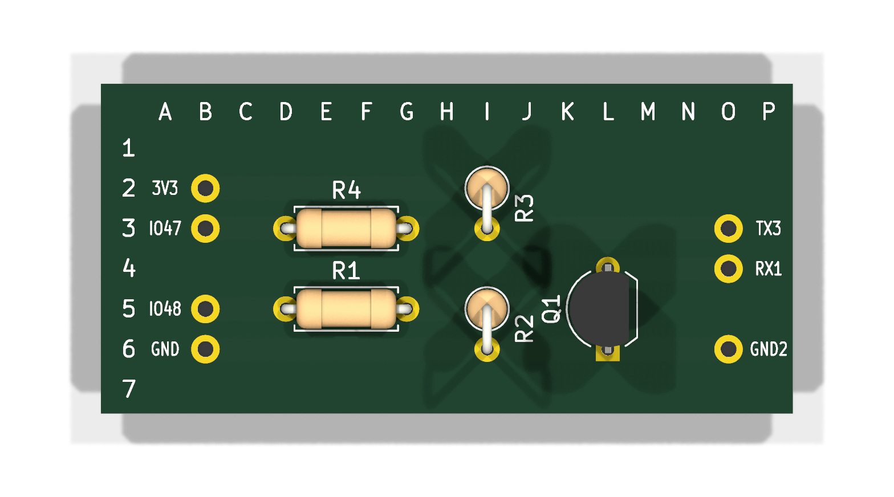
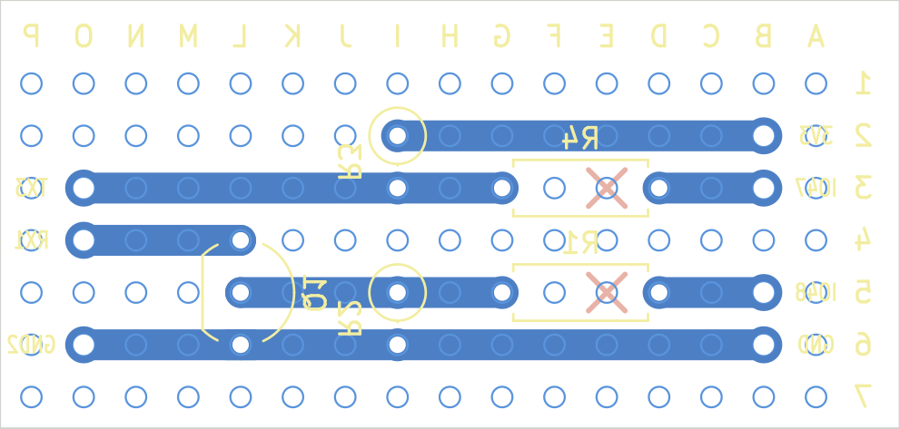

# Minitel 2 ↔ Heltec V3 interface: stripboard build

Small level-interface board between the Minitel DIN-5 port and a Heltec WiFi
LoRa 32 V3. The V3 is not mounted on the board: both the V3 and the DIN plug
are wired to it with flying wires.



Sources: `minitel_if.kicad_sch` / `minitel_if.kicad_pcb`. Both are generated by
`gen_sch.py` and `gen_pcb.py`. Edit the scripts and re-run; don't edit the
KiCad files by hand.
Checks: ERC 0, DRC 0, 0 unconnected, schematic parity 0.

## Circuit

| Net | Path |
|---|---|
| ESP → Minitel | GPIO48 (UART TX, **output inverted in software**) → R1 1k → Q1 base. Q1 collector sinks DIN 1 (RX). The Minitel supplies the pull-up. R2 10k keeps Q1 off while the ESP boots, so the line idles high. |
| Minitel → ESP | DIN 3 (TX, open collector) is pulled up to 3V3 by R3 10k, then goes through R4 10k to GPIO47 (UART RX, not inverted). |
| GND | DIN 2 ↔ V3 GND |
| DIN 4 (PT), DIN 5 | **Not connected.** PT is ignored in the 80-column modes. On the Minitel 2, pin 5 is a supply output (8.5–15 V): insulate it and never wire it to the ESP. |

The V3 is powered from USB 5 V. The only connection shared with the Minitel is GND.

### Acceptable resistor ranges

Only two values are needed: 1k and 10k.

| Ref | Role | Range | Limit |
|---|---|---|---|
| R1 | Q1 base drive | 470 Ω – 10k | low end: GPIO current; high end: Q1 must saturate against the Minitel's pull-up (about 0.5 mA per the 800 Ω spec test; the real Minitel 2 value is unmeasured) |
| R2 | base pull-down | 10k – 100k, optional | must be much larger than R1 |
| R3 | pull-up on Minitel TX | 1.5k – 47k | low end: the Minitel output only guarantees ≤ 0.4 V up to 2.2 mA; high end: rise time |
| R4 | series protection | 0 Ω – 10k | the GPIO input draws no DC current |

With a single value, all-10k with R2 left out also works if the Minitel's pull-up is weak.

## Board

- 16 × 7 holes (columns A–P, rows 1–7), strips running horizontally.
- Rows 1 and 7 are spare.
- Coordinates match the letters and numbers in the pictures. Columns are lettered from the component side; seen from the copper side, A is on the right.



### 1. Cuts (copper side)

| Cut | Why |
|---|---|
| **E3** | Separates GPIO47 (B3–D3) from MT_TX (G3–O3) under R4 |
| **E5** | Separates GPIO48 (B5–D5) from Q1_B (G5–L5) under R1 |

Use a 4 mm drill bit or a spot-face cutter. Check with a multimeter that D3–G3 and D5–G5 are open.

### 2. Parts (component side)

| Ref | Value | Holes | Notes |
|---|---|---|---|
| R4 | 10k | D3 – G3 | lying flat, over the cut |
| R1 | 1k | D5 – G5 | lying flat, over the cut |
| R3 | 10k | I2 – I3 | standing |
| R2 | 10k | I5 – I6 | standing |
| Q1 | 2N2222 (TO-92, PN2222A pinout) | **E = L6, B = L5, C = L4** | flat face toward column M |

The TO-92 2N2222/PN2222A is E-B-C. That is the reverse of a BC547 (C-B-E),
and a few makers differ. Check yours with the multimeter's diode test: the
base is the pin that conducts to both others, and B→E reads slightly higher
than B→C. A metal-can 2N2222 (TO-18) works too: the tab marks the emitter.

### 3. Wires

| Hole | Label | To |
|---|---|---|
| B2 | 3V3 | V3 **3V3** (J3 pin 2 or 3) |
| B3 | IO47 | V3 **GPIO47** (J2 pin 13) |
| B5 | IO48 | V3 **GPIO48** (J2 pin 14) |
| B6 | GND | V3 **GND** (J2 or J3 pin 1) |
| O3 | TX3 | DIN pin **3** (Minitel TX) |
| O4 | RX1 | DIN pin **1** (Minitel RX) |
| O6 | GND2 | DIN pin **2** (GND, and the shield if the cable has one) |

- **Plug:** a 5-pin 180° DIN **male** plug, the "MIDI" type; an old MIDI or audio cable cut in half works.
- **Pin numbers:** pin 2 is the middle pin. Most plugs print the numbers on the insert; otherwise confirm each wire with a continuity test before soldering it to the board.

### 4. Checks before the first power-up

1. With nothing connected:
   - B2–B6 (3V3–GND): no short.
   - I2–I3 reads 10k.
   - B3–O3 reads 10k (R4).
   - L5–B5 reads 1k (R1).
2. V3 on USB, Minitel unplugged:
   - O3 and B3 read about 3.3 V.
   - O4 floats, because the pull-up lives in the Minitel.
3. Minitel on, V3 off:
   - Measure DIN 1 (O4) to GND. This is the Minitel's own pull-up voltage, unknown on the Minitel 2 and expected between 5 and 15 V. The 2N2222 is fine up to 40 V.

## Firmware notes

```cpp
Serial1.begin(1200, SERIAL_7E1, /*rx*/47, /*tx*/48);   // the Minitel boots at 1200 bd
uart_set_line_inverse(UART_NUM_1, UART_SIGNAL_TXD_INV); // invert TX only (Q1 inverts it back)
```

`HardwareSerial::begin(..., invert=true)` would invert RX as well. Don't use it.

Mode and protocol notes are in `../ref/minitel2-80col-notes.md`:
- 80-column Mixte mode, echo off;
- speed change to 9600 bd;
- key codes;
- the 3 h standby reset.
